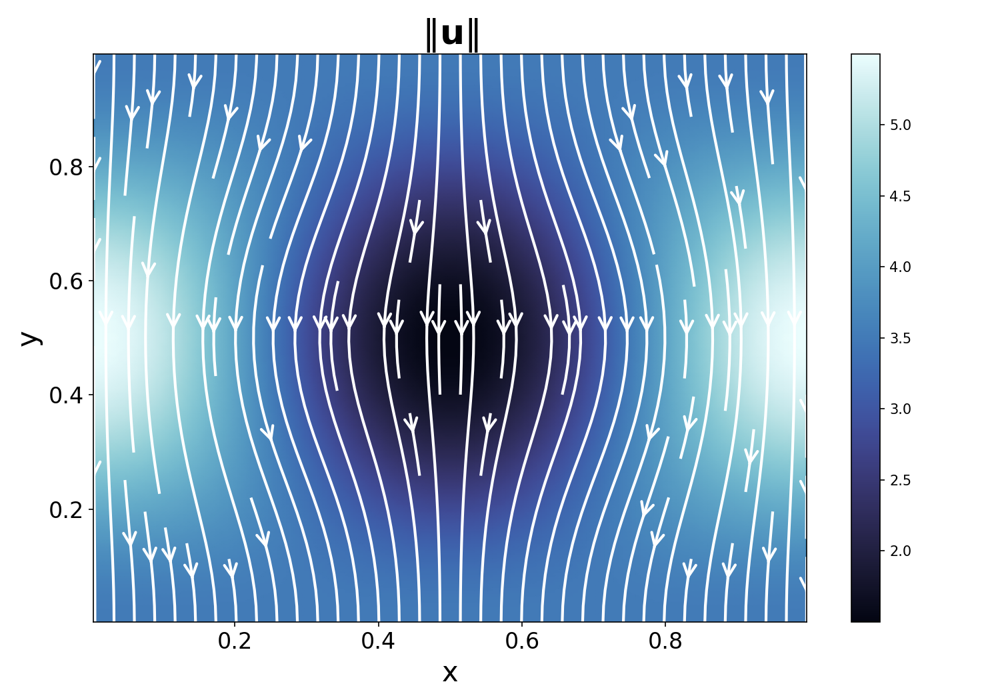
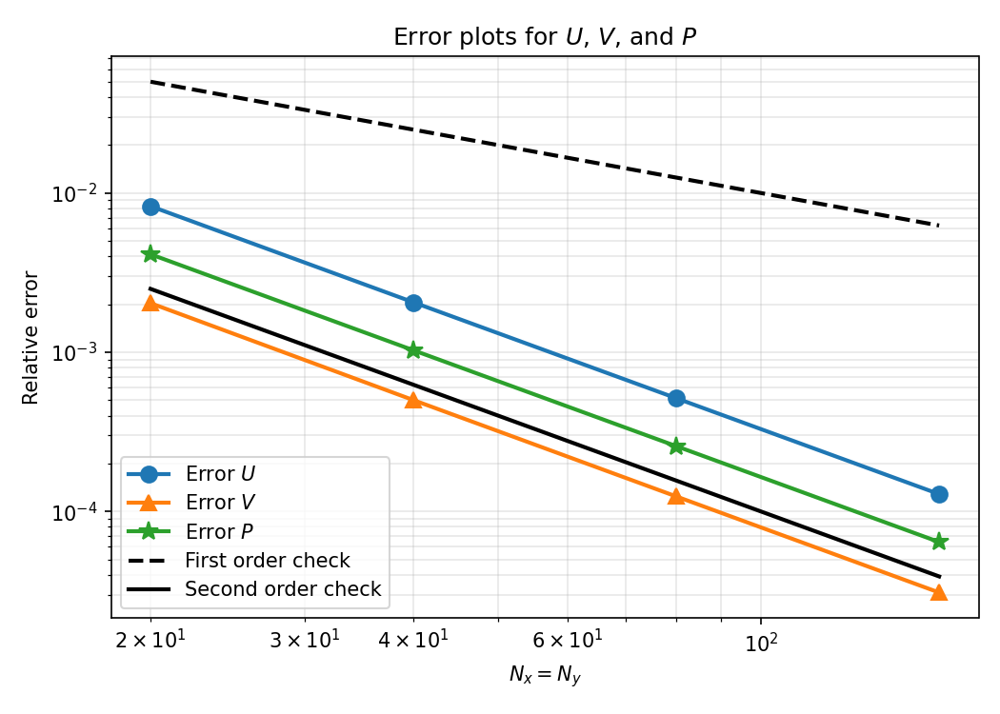
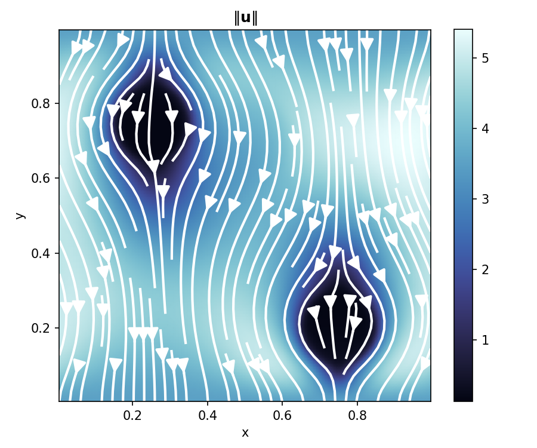

# MATH550 Homework 1: Solving the Stokes Equations in 2D on a Staggered Grid

## System Definitions
### Why P has no boundary condition?
The velocity boundary conditions fix the normal flux so adding a pressure condition would over-determine the problem. Additionally, the equations involve only the gradient of $P$, so adding a constant doesn't change anything.

## Problem 1

### Figure 1

The computed speed $\| u \|$ with streamlines show the low moves downard everywhere, slowest at the center and fastest at the periodic edges. This matches the manufactured solution and Figure 2 in the homework pdf.

## Problem 2
### Figure 2

The relative errors in U, V, and P vs the grid size. All three decrease at the same rate as the second-order reference line. This confirms $O(h^2)$ convergence.

## Problem 3
For problem 3 I decided to try to simulate the flow through some kind of porous microstructure. Based off of my research Darcy's Law is 
\[u = - \frac{\kappa}{\mu} \nabla P\] 
And the Stokes Darcy Equations would be 
\[\mu \nabla^2 u - \nabla P - \frac{\mu}{\kappa} u = b\]
\[\nabla \cdot u = 0]
I set $ \mu = 1$ and decied to have two circular grains of a porous structure. 

## Figure 3

Using the Stokes-Darcy equations, two low-permeability discs centered near (0.25, 0.72) and (0.75, 0.22) act as obstacles in the downward $V = -3.5$ flow. The speed drops nearly to zero inside each disc, and the fluid is diverted around them, accelerating to about 5 in the open regions between.